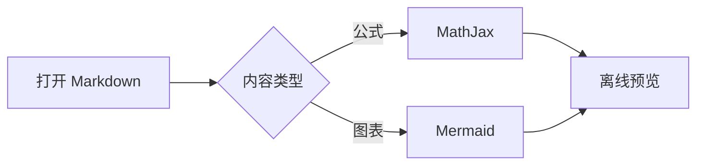
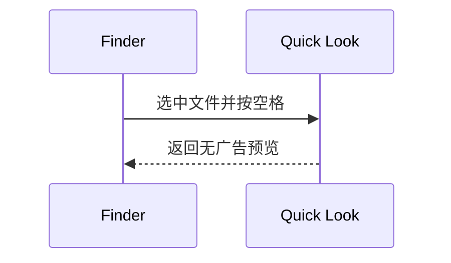

# 图表与数学公式

## 行内公式

质能关系 $E = mc^2$，下标 $x_i + y_j$，以及 $\frac{1}{2}$。

转义写法 \(a^2+b^2=c^2\)，GitHub 写法 $`\sqrt{x^2+y^2}`$。

普通价格 $20 和 $30 不应变成公式。转义美元 \$100 保持原文。

## 块级公式

$$
\int_0^1 x^2\,dx = \frac{1}{3}
$$

\[
\begin{pmatrix} a & b \\ c & d \end{pmatrix}
\]

```math
\begin{aligned}
f(x) &= x^2 + 2x + 1 \\
     &= (x+1)^2
\end{aligned}
```

## 流程图



## 时序图



## 普通代码保持原样

`$x_i$` 和 `\(x\)` 不应被转换。

```python
price = "$20"
formula = "$x_i$"
```
